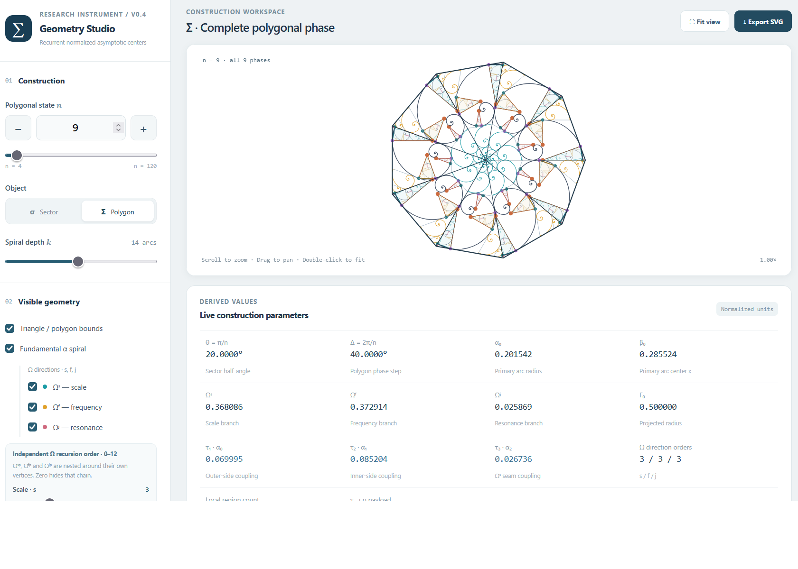

# RNACC Geometry Studio

**An interactive browser-based exploration of normalized polygon geometry, recursive arcs, and vector rendering.**

## Overview
This portfolio project translates geometric formulas into an interactive web interface. The documented application includes adjustable polygon state and spiral depth, SVG rendering, layer visibility, pan/zoom, calculated parameters, and SVG export.

**Application stack:** HTML, CSS, JavaScript ES modules, SVG; Node.js for optional automated tests. Java packaging is separate from the browser runtime.

**Architecture described in the original application README:**
- `src/math.js` — numeric functions
- `src/geometry.js` — geometric constructions
- `src/render.js` — SVG output
- `src/app.js` — user interface and export
- `tests/geometry.test.js` — validation tests

## Source-code publication status
**The actual JS/HTML/CSS application source was not supplied for this starter package.** Import your project files before describing this repository as a runnable demo. Expected files: `index.html`, `styles.css`, `src/`, `tests/`, `examples/`, `package.json`. Then use a static local server (such as VS Code Live Server) and run `npm test` if Node.js is available.

## Mathematical specification
- [Condensed mathematical paper (PDF)](paper/rnacc_geometric_construction.pdf)
- [Editable LaTeX paper](paper/rnacc_geometric_construction.tex)
- **Zenodo DOI:** 10.5281/zenodo.24163661.

The paper extracts a mathematical skeleton from *The Recurrent Normalized Asymptotic Centers of Correspondence* (Silent Emry, October 2026). It distinguishes defined constructions from implementation conventions; it does not claim established physical results.

## Authorship
Mathematical framework: **Silent Emry**. https://zenodo.org/records/24163661

## License
Copyright (C) 2026 Zachary D. Ulrich. Released under CC BY 4.0 license. 
